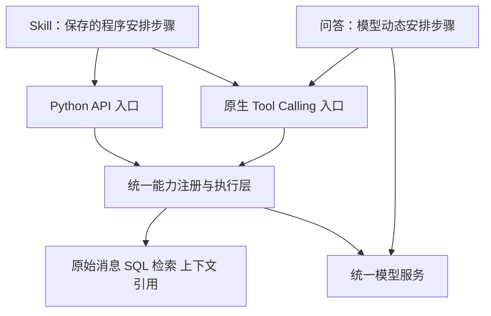
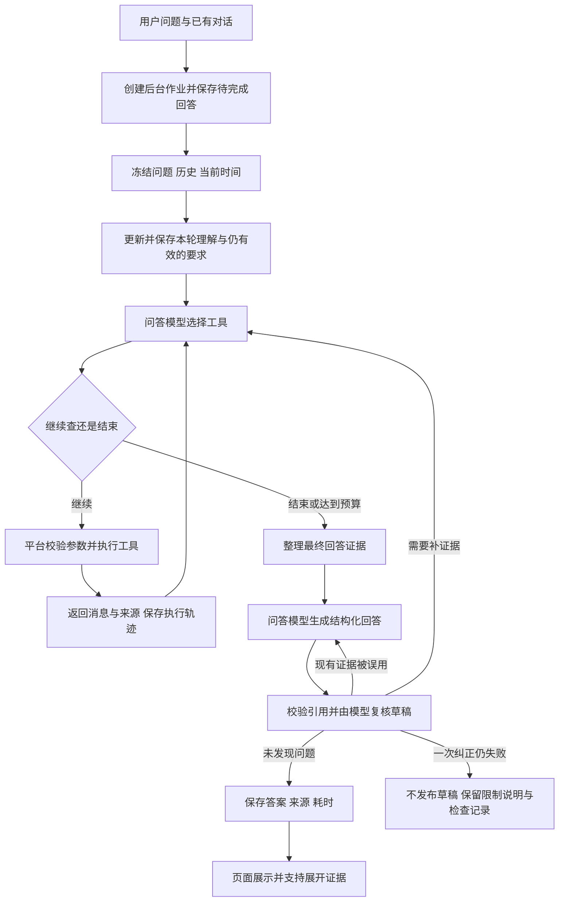
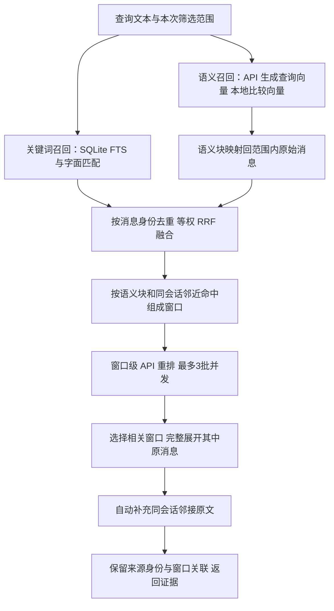
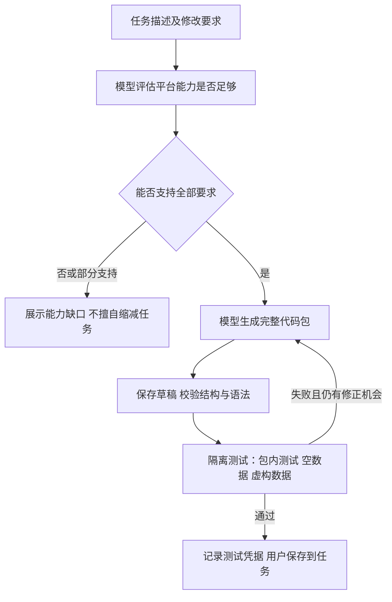
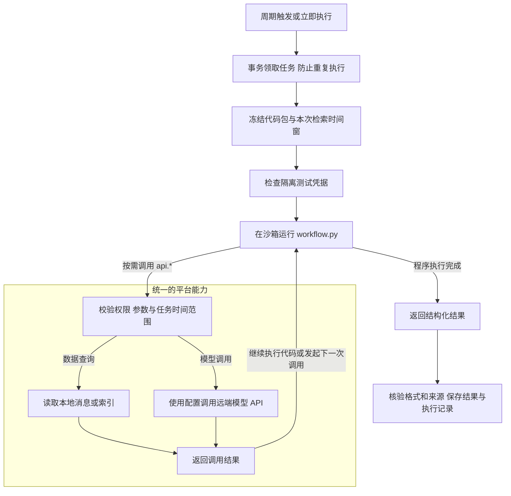

# WeChat Agent：问答与任务执行流程

更新：2026-11-01。本文描述统一平台能力后的当前代码，不包含已删除的旧执行方案。

## 1. 总览：谁决定下一步

**问答：模型边查边决定。任务：执行保存好的 Skill，由其中的程序决定。**

| | 聊天问答 | 任务助手 |
| --- | --- | --- |
| 触发 | 用户提问、继续追问 | 周期到期、立即执行 |
| 流程控制 | LangGraph 中的模型决策循环 | 任务自己的 `workflow.py` |
| 模型做什么 | 理解问题、选择工具、根据证据回答 | 创建时生成程序；执行时按程序要求分析或补查 |
| 是否每次生成代码 | 否 | 否，保存后重复执行，修改时再生成或编辑 |
| 是否每次调用模型 | 正常有证据的问答需要 | 不一定，纯规则任务可以不调用 |
| 时间范围 | 模型为每次工具调用选择条件，受数据边界约束 | 启动时冻结任务时间窗，程序不能越界 |
| 共用能力 | 人物、会话、检索、原始消息、只读 SQL、上下文、模型调用 | 同一实现，通过 Python API 或原生工具调用使用 |

当前技术实现是 **Python HTTP 服务 + LangGraph + SQLite + 原生 Tool Calling + 自建混合检索**，不是 LlamaIndex 或 Streamlit。



两边共用 `PlatformAPI` 和 `create_platform_runtime`。Python API 可返回完整结果，模型工具入口提供明确的分页与覆盖信息；不是分别维护两套查询实现。模型配置仍可分别选择“问答”和“任务”，统一服务不等于强制使用同一个模型。任务私有状态不暴露成跨任务共享状态，问答自身的对话与检查点由问答编排器管理。

## 2. 聊天问答：一次问题如何得到答案



决策输入使用一份消息目录和正文预览，按会话/时间分组展示，不重复发送重叠邻接图；完整原文与精确上下文仍保存在平台，最终答案保留完整窗口。工具定义仅声明 ID 类型格式，具体成员资格由平台检查，不在每个工具中重复枚举全部 ID。任务、人物、时间边界并未因压缩而删除。

共享模型服务使用 Chat Completions SSE 流式接收并组装结构化结果。页面显示等待/接收状态与接收字符数，只有完整 JSON、工具参数和引用校验后才执行工具或发布结果。分别记录响应头、首个 SSE 数据事件、首段文本/工具参数、完整响应的耗时；首个事件可能仅包含角色，不等于首段内容。请求字符数包含工具定义，输入 token 数以服务端 usage 为准。兼容服务若返回普通 JSON，接受该响应并标明非流式，不额外重发请求。中断不写入完成回执，不自动重试付费请求。流式接收改善可观察性，并不保证模型推理更快。

### 2.1 先保存，再执行

前端通过后台作业接口提交问题。服务端先保存用户消息和待完成回答，然后执行 `run_qa_stream`。历史以服务端保存的会话为准，排除失败、未完成和已停止的回答。

本轮问题、历史和请求时间会冻结，因此中断恢复不会把原问题中的“今天”变成恢复当天。同一会话的执行受并发保护，页面切换不会取消服务端作业。

当前入口还会准备联系人索引、检查是否存在聊天内容，但**不会因此把问题限制到某几个联系人**。

### 2.2 不先填槽位，直接选择工具

图中的实际顺序是：

```text
初始化数据边界 → 更新本轮任务 → 模型决定 → 执行工具 → 模型决定 → …… → 生成草稿 → 回答检查
```

模型得到问题、近期问答历史、当前时间、已取得的证据和工具结果，直接返回原生 `tool_calls`。例如可以先查 NTU 相关群，再定位两个人，最后查他们在这些群里的消息和邻接上下文。

追问先由 `qa_task.py` 根据保存的用户发言和上轮任务生成结构化的“本轮理解”：完整请求、预期结果、仍有效的要求及用户原话出处。第一轮直接保存原问题，不额外调用模型。旧要求不会因本轮未提到而消失；删除要求必须引用后续用户发言。检索决策、回答生成和回答复核共用这份任务，页面可展开查看并在下一轮纠正。它不预设人物、时间或主题槽位；语义解释仍由模型负责，出处校验不等于理解必然正确。

任务要求区分必须遵守的边界（constraint）、判断重点（priority）和补充参考（reference）。参考材料缺失可说明局限，不能自动变成必须补齐的条件。旧版任务会根据原始用户发言重新解释一次，避免继承被放大的要求。

用户明确排除人物时，模型先确认身份，再通过 `filters.exclude_person_ids` 传入已取得的人物 ID。共享检索在召回、排序和上下文展开前排除该人的私聊及其群内发言；不删除其他群成员的发言。问答本轮后续共享查询保留已确认的排除条件。原始读取与自定义 SQL 仍是低层能力，模型需遵循用户要求；排除条件不是权限或隐私隔离边界。

决策记录每次搜索的新增证据数量和来源会话分布。补查应对应检查意见中的对象或证据缺口；空结果不再触发“两次即结束”。完全相同的工具请求不重复执行，而返回结构化错误供模型调整；仍受整轮8步工具预算约束。名称范围匹配0个会话时，先返回范围诊断，不进行付费正文检索，也不自动放宽用户边界。检查允许有依据、明确范围的暂定候选，不要求证明全库绝对第一；事实错误、无依据断言和违反明确要求仍不放行。

需要跨会话比较时，模型可设置 `filters.diversify_by_chat=true`：按相关性取每个会话的最高分窗口优先返回，再补同会话窗口，不改变评分；至少保留两个完整会话窗口（若有），随后遵守消息目标数。它由调用者选择，不按业务关键词自动路由。初次核验发现问题后只进行一轮针对性纠正：已有证据足够则改写，需要补证据则返回工具决策；相同草稿、证据、任务和覆盖范围直接复用核验结果。共享问答模型的网络读取等待上限为 180 秒（不是整轮问答时限）；超时不自动重发，继续执行仍需要确认可能计费的重试。

平台不再先用本地规则判断“美食问题”“最近问题”，也不维护全局人物、日期、主题槽位。人物和会话 ID 必须来自已经看到的工具结果；每步的筛选条件独立校验，不会无条件继承上一步的窄范围。

工具调用结构有效但参数不合法（例如截止日期晚于本轮冻结时间）时，不执行查询；平台返回配对的结构化错误和允许的数据边界，让模型修正后继续。错误尝试同样消耗步骤预算，避免无限重试。未知工具、破损协议和模型请求失败仍明确报错。正文检索不要求预先查找人物，人物发现仅用于需要指定身份的查询。

**没有全局槽位，不等于没有筛选条件。** 模型仍可以明确指定会话、人物、日期；这些是一次工具调用的参数，不是平台凭关键词提前锁定的路由。

### 2.3 多轮交互实际上怎么发生

```text
平台 → 模型：问题、历史、证据、工具定义
模型 → 平台：tool_call，例如 search(query=..., chat_ids=...)
平台：校验参数，在本机查询数据
平台 → 模型：带 tool_call_id 的工具结果
模型：继续补查，或调用 finish
```

远端模型不能直接读取本机数据库。每次都由平台发起 API 请求，再执行模型提出且通过校验的工具调用。

### 2.4 回答与引用

调用 `finish` 时，模型可以选择已取得的证据；与所选主证据关联的周边消息也会保留。生产问答不再按 20/60 条截断最终证据，而按可配置的正文字符预算保留完整邻接窗口，默认 120000 字符。检索参考条数不是最终回答的消息上限。放不下的窗口整体省略并标记覆盖不完整；全部放不下时返回限制说明，不拿孤立短句生成结论。字符预算不是模型 token 容量，提示词、元数据、历史、工具和输出还需额外空间；这里不自动识别模型最大上下文。横向评测单独启用统一的最终条数上限，扩展后再限制、再生成与计分。

回答模型返回包含 `kind`、`text`、`source_refs` 的段落数据。平台校验格式及引用范围，前端用真实来源元数据展示会话、私聊或群聊类型、发送者、时间和原文，而不是让模型自行编造来源标签。

每次生成（包括修正草稿）按本轮最终证据数构造严格输出 Schema：引用只能是 `1..N` 的整数，实质回答至少有一个引用；零证据时只能生成无引用的限制说明。历史轮次和未纳入最终上下文的检索编号不扩大这个范围。返回后再校验，兼容接口若忽略 Schema 最多修复一次，仍不合法则报错，不删除错误引用冒充成功。这是回答输出约束，不额外增加引用工具调用。

没有证据时返回“尚不能回答”，不将其解释成“相关消息不存在”。检索未穷尽或上下文被截断时保留限制说明。**引用编号有效只证明来源确实被检索到，不保证模型对原文的理解一定正确。**

有证据的草稿再经过一次独立模型请求复核（沿用问答模型配置，不是独立模型裁判）。检查问题覆盖、证据矛盾和引用支持：已有证据足够则修正草稿；仍缺证据则回到工具循环，并恢复之前选取证据前的工作集。最多纠正一次，然后作最终检查；仍有问题时不发布被否定的草稿，仅保留限制说明和检查记录。

复核仍逐段检查支持或反驳证据，并检查问题覆盖；通过项不重复撰写理由，问题项只写一句具体缺口（最多240字符）。程序检查段落是否全部被检查、来源编号是否合法，再根据各项结果决定路径，不直接接受一个总的“通过”标记。但这些语义判断仍来自模型，**不是正确性保证**，仍可能漏判。没有写死问题类型、最低检索次数或具体任务规则；正确回答可直接通过，也允许有依据的“无法确认”。正常回答多一次模型请求，纠正会增加耗时和用量。查询过程展示复核意见；复核本身同样有持久化回执，结果未知的付费请求必须确认后才能重试。

最终答案、证据、检索过程和耗时更新到本轮 `turn_id`，不会用整个旧页面状态覆盖后来新增的对话。

复核还必须对完整请求、预期结果和每个仍有效的要求分别给出结论。即使逐句引用正确，只要遗漏排除条件或没有足够比较证据，仍进入改写或补查，不能凭一个总体“通过”放行。

## 3. 共用检索：search 内部做什么

`query` 表达本轮检索目标，也是合并候选后的重排依据；`queries` 可提供最多 6 条独立的消息内容查询，留空时使用 `query`。这些内容查询并行召回，按消息身份合并后统一重排，查询过程可展开查看各条查询的召回数量。

`filters.chat_title_contains` 只匹配会话显示名称的连续子串，不搜索正文，也不拆分关键词。没有明确名称范围时留空；名称条件匹配不到会话时，平台返回 `empty_chat_scope` 和范围诊断，不发起付费召回，也不擅自放宽用户条件。模型可根据诊断修正参数。旧 Skill 的 `chat_keyword` 仅在入口映射为这个名称字段，不改变旧参数语义。



1. **先应用范围。** 会话、人物和时间条件在各路召回时生效，语义块回查消息时再次过滤。不是全局取前 N 条后才筛指定群。
2. **多路召回。** Embedding API 只负责生成向量，相似度比较在本机完成；SQLite 提供全文和字面匹配补充。
3. **统一候选身份。** 语义块先映射回消息，与关键词命中的消息去重，保留其所属语义块作为重排参考。
4. **等权 RRF 融合。** 根据各路名次合并，不加美食词、推荐词或消息新旧等业务分数。
5. **窗口级 API 重排。** 语义块中的范围内原消息组成评分窗口，重叠的关键词命中只保留一次；其余关键词命中按同会话、相邻间隔不超过 30 分钟组成窗口。窗口超过 6000 字符或 48 条消息时拆分，不跨会话。每个窗口评分一次，不再为块内每条消息重复提交整块上下文。保留全部召回候选参与评分，不增加业务词加分。
6. **返回消息证据与邻接窗口。** 按相关性选窗口并完整展开原消息；`size` 是消息目标数，末个窗口允许超过目标，避免截掉末尾更正。每个命中额外带上同会话前后各 3 条起、30 分钟内的原文。边界上同一发送者的连续发言继续补齐，要求相邻两条间隔不超过 2 分钟，最多各 12 条，并遵守本次时间边界。邻接消息保持真实身份并去重。诊断分别记录候选消息数、评分窗口数、命中数和新增上下文数。

RRF 仍然产生本地顺序，但不承担业务判断：用于融合及重排同分时的稳定排序。Embedding 和 Rerank 是混合检索的必需配置，不再提供启停开关。重排批大小默认 48 个窗口，是每次 API 请求的数量，不是所有候选的总上限；不同于单窗口最多 48 条消息。

模型通信统一采用严格的工具参数或 JSON Schema 输出。重排按本批候选生成 `scores.c1` 到 `scores.cN` 的必填字段，每项包含 0–1 的 `score` 和 `reason`，禁止未知字段；不再依靠模型自行输出长度正确的数组。平台再次校验 JSON、类型、范围与完整性，拒绝重复键、非有限数值、截断和拒绝响应。格式修复最多一次，并附上具体缺失字段；网络失败不会作为格式错误自动重发。

SQL 快照超过本地容量预算时，共享工具返回 `error.code=sql_scope_too_large`、`complete=false`、`matched=null`，模型可改用其他工具或分段查询，不会把查询失败伪装成零匹配。此处理只适用于已知的本地范围错误；付费请求超时、权限问题和无效重排结果仍明确中止并保留检查点。

问答、回答复核和 Skill 生成保留各自的结构化格式。Skill 的 `api.llm` 自定义 Schema 会在返回程序前校验；未提供 Schema 时，线上使用 `{ "text": "…" }` 包装，平台解包成原有字符串，已有 Skill 调用方式不变。工具回执继续使用结构化数据，自然语言问题与聊天原文保留原文。Embedding 和语音转写使用各自的原生 API 协议。此输出协议变更前的未完成问答需重新提问，历史结果保留。

重排每次最多同时请求 3 批；完成后才补入下一批，全部评分完成后统一排序，不按返回先后排序。每批有稳定的回执命名空间，格式修复请求也单独保存。恢复时复用已完成响应；结果未知的付费请求仍需确认。旧执行中的串行回执沿用原编号续跑，避免迁移时重复请求。问答和 Skill 共用此执行器，额外批次和格式修复仍计入各自模型调用预算。

查询过程可展开查看查询 Embedding、本地向量匹配、关键词召回与回查、重排墙钟时间、邻接窗口展开及各批耗时。并发批次耗时不能相加当作总等待时间；语义召回总耗时包含查询 Embedding 和本地匹配。恢复命中回执的步骤等待时间可能接近零。

“全部候选重排”不等于“全库所有消息重排”：语义、全文和字面召回本身仍有数量预算。问答和 Skill 的共享工具遇到语义或重排错误都会明确失败，不伪装成完整执行；独立检索调试器仍能显示底层 RRF 降级结果及错误。检索服务缺少配置时，共享 search 在准备索引或发起付费调用前明确报错。

### 三种上下文，不能混为一谈

| 上下文 | 怎么得到 | 用途 |
| --- | --- | --- |
| 问答历史 | 当前会话已保存的用户问题和助手回答 | 理解“她”“刚才那个”等追问，不是本轮事实证据 |
| 语义块上下文 | 向量命中块中的相邻聊天文本 | 作为窗口参与重排，选中后回查出的真实消息才能进入引用集合 |
| 消息前后文 | 共享 `search` 自动带入邻接窗口；也可用上下文或时间线工具扩大 | 进入证据工作集，可供最终分析和引用 |

**search 现在自动带上有限的前后文，但不是整段会话。** `context_ids` / `context_for` 记录原文关系，回答和复核模型都能看到按时间排序的引用编号窗口。相邻不代表同一话题或直接回复；具体指代仍由模型结合原文判断，需要更长上下文时可以补查。

决策模型每轮只接收一份完整证据目录、一个有界原文预览和使用整数引用的上下文窗口。旧工具回执保留调用配对、结果数量与分页信息，不反复携带原文及长 ID 关联图；人物和会话信息集中在观察结果中。本地完整证据和最终回答输入不因此缩减，工具参数仍使用真实 `evidence_id`。模型请求的字符数、返回的输入 token 用量和耗时也保存在诊断中。

原文预览对整个证据目录共享 30000 字符预算，旧工具回执不能绕过预算重新插入全文。此预算只限制决策阶段的预览，完整证据仍在本机保存，最终回答使用独立的证据预算。

回答输入不再按相关性把短句散列：先按会话分组，再按时间排列原文；间隔超过半小时另起展示块。引用编号仍对应冻结的来源列表，不因重排阅读顺序而改变。展示块不是平台判定的“同一话题”。

共享 `surrounding` 使用同一邻接读取逻辑，并核验索引锚点是否仍指向原消息。问答和 Skill 的共享 `search` 都获得自动展开；低层 `api.semantic_search` 仍保持召回接口语义，由 Skill 显式调用上下文能力。纯 SQL 任务不增加模型调用。

## 4. 任务助手：生成和执行是两件事

### 4.1 创建或修改 Skill



生成模型得到任务需求、消息及索引结构、平台 API 和能力说明，**这个阶段不读取真实聊天**。生成与修正最多三轮。

| 包内文件 | 含义 |
| --- | --- |
| `workflow.py` | 完整执行程序，包括规则、查询、模型调用和结果整理 |
| `manifest.json` | 入口、权限、执行时间和调用预算 |
| `SKILL.md` | 面向人的流程说明 |
| `test_skill.py` | 包内测试 |
| `PLATFORM_API.md` | 平台接口契约，由平台提供 |
| `CAPABILITIES.json` | 生成时的平台能力评估报告 |

隔离测试用虚构消息和模拟模型，验证程序与平台接口能衔接，不代表真实任务效果已经通过人工评估。测试凭据绑定代码包、任务描述和运行时版本；修改后需要重新测试。

个性化规则保存在任务包里，不通过修改平台源码实现。平台仍需预先提供通用数据接口、安全约束和模型接口；“自定义 Skill”并不意味着生成代码可以任意访问电脑或网络。

### 4.2 周期到期或立即执行



以“每 6 小时运行，检索最近 1 天”为例，每次从启动时间向前取一天；手动执行也一样，**不是从上次成功时间开始增量裁切**。启用定时的任务手动执行后，会从本次启动时间重新计算下次运行时间。

当前任务助手全局串行，领取任务通过数据库事务保护。服务停止期间错过的周期合并为一次，不会恢复后无限补跑。

Skill 在 macOS 沙箱中运行，不能直接取得密钥、访问真实数据库文件或自行联网。`api.*` 调用通过受控通道交给宿主完成，再把结果返回程序。

图中的数据查询和模型调用都属于平台能力，由 Skill 按需选择，不要求每次都走模型分支。例如忘回私聊示例只调用数据接口，再用包内代码判断最后发送者，执行时不调用大模型。

**Skill 可以多轮调用模型，但不是平台替每个 Skill 自动循环。** 程序需要自己保存对话、调用 `api.llm`、处理 `tool_calls`、执行 `api.tool` 并回填工具结果；也可以完全不用模型。

## 5. 两种示例 Skill 的具体流程

以下以仓库中的示例包为准。任务中保存的包可以独立修改，不保证始终与示例文件相同。

### 5.1 忘回私聊：本地规则，不发送所有消息给模型

```text
列出时间窗内活跃会话
→ 筛选私聊
→ 每批最多 100 个会话，读取每个会话最后一条物理消息
→ 比较发送者身份与自己的账户身份
→ 对方发出且之后没有自己消息的，列为候选
→ 登记引用，返回结构化结果
```

读取原始消息而非全文索引，避免表情、通话等无普通正文的消息被忽略。身份或顺序无法确定时不能武断判断。

这里判断的是**消息顺序上的未回复候选**，不是语义上“必须回复”。寒暄、表情、通知是否需要回复，不能仅靠最后发送者证明。当前示例不调用模型，也不使用 Embedding。

代码：[忘回私聊示例](../examples/skills/unanswered/workflow.py)。

### 5.2 实习信息：召回、上下文、模型分析与补查

```text
以任务描述做语义召回 + 包内 SQL 关键词补召回
→ 按消息身份去重
→ 读取前后文并组成上下文窗口
→ 按窗口分批，给原文登记引用
→ 任务模型提取信息，必要时调用共享工具继续查
→ 校验输出和引用
→ 合并相同事实，保留更正或冲突信息
```

该包使用 `api.semantic_search` 加自己的 SQL，不是每一步都走共享混合 `search`。模型补查时可以使用共享 `search`，这时才进入前述混合召回与重排链。

当前示例前后文各取 3 条、最大间隔 30 分钟；按完整窗口组织不超过 30000 字符的批次。单窗口过大时明确失败，不静默截断。初始召回为空也会让模型尝试改写和补查，不能把工具错误当成“没有岗位”。

包中的实习关键词是**这个任务自己可编辑的规则**，不是平台检索器里的业务加分。当前示例也不是跨次执行的新消息去重器，滚动时间窗重叠时可能再次报告同一信息。

代码：[实习信息示例](../examples/skills/internships/workflow.py)。

## 6. 平台工具、索引与模型的分工

### 共用工具与 Skill 扩展接口

| 工具或接口 | 能力 |
| --- | --- |
| `find_people` / `list_chats` | 找人物与会话，获得可用的真实 ID |
| `search` | 范围内混合检索与 API 重排 |
| `timeline` / `surrounding` | 时间线、命中消息周边原文 |
| `shared_windows` | 查看多人共同出现的会话时间窗口，不等于证明互相对话 |
| `statistics` / `unanswered` | 索引统计、未回复候选查询 |
| `finish` | 结束本轮工具检索 |
| `read_chats/read_messages/read_messages_batch`；Python `api.chats/messages/messages_batch` | 同一原始会话和消息读取能力；原生工具按返回页纳入证据 |
| `query_messages`；Python `api.query` | 执行时间窗内的只读 SQL；可再用 since/until 缩小快照，聚合返回计算摘要而非原文 |
| `semantic_search`；Python `api.semantic_search` | 同一阈值语义查询；原生入口支持分页，不与混合 `search` 混淆 |
| `message_context`；Python `api.surrounding` | 同一可调条数及间隔的前后文能力，支持原始消息和索引消息 |
| Skill `api.llm/tools/tool` | 调模型、获取工具定义、执行共用工具 |
| Skill `api.cite` / 状态接口 | 登记真实来源、读取或暂存任务跨轮状态 |

共享工具里的 `evidence_id` 用来选择已取得的证据，最终结果的 `source_refs` 是展示用引用编号，不能直接混用。Skill 的 `api.cite` 负责核验来源并返回引用编号。

### 模型工具 ID 隔离

问答决策模型和 Skill 的 `api.llm(..., tools=...)` 共用 `model_ids.py`：模型工具参数使用 `chat_…`、`person_…`、`evidence_…` 三种不同命名空间。即使会话和发送者在微信中具有同一个原始 ID，模型句柄也不同。目录、结构化工具回执、历史工具调用参数一起转换；每次请求从已返回的记录重建有效集合，不把未返回的分页数据算作已知身份。

工具 Schema 在集合较小时列出可选句柄，超过枚举预算时保留类型前缀约束；所有调用仍须通过服务端精确集合校验。输入通过后再还原为真实 ID 并沿用原权限、时间范围和证据检查。它不是安全权限的替代，也不代表模型选择了正确的人。

这层转换只作用于模型工具协议：数据库、本地 Python/SQL API、已保存的来源和界面引用保持原始字段；代码 Skill 收到的模型工具参数会还原为原接口形式，已有包不必重写。SQL 是低层代码接口，不具备按 SQL 列推断 ID 类型的能力；模型可在 `params` 中传已登记句柄，由平台转换为绑定参数，不能把句柄直接拼进 SQL。用户正文和聊天原文不做字符串替换。

问答协议版本已更新，旧版未完成执行不能按新协议恢复，需要重新提问；已保存的历史回答不受影响。

### 索引依赖按需准备

```text
同步聊天 + 已完成语音转写
          ↓
      全文消息索引
          ↓
      语义块与向量索引
```

Skill 只读原始消息时不要求先建索引。SQL 或共享索引工具会按需准备全文索引；语义查询还会准备语义索引。维护过程受锁保护，进度与索引 Embedding 用量单独记录。

问答现在复用同一套按需准备逻辑：读取原始消息不建索引，SQL 和索引工具准备全文索引，语义工具再准备向量索引。更新失败明确报错，两边不会各自采用不同的静默降级规则。

这也不等于每个任务都会自动同步微信、转写所有语音。任务读取当前已同步数据和已有转写；完整 RAG 更新链才按“语音转文字 → 全文索引 → 语义索引”执行。

### 模型配置

| 配置 | 使用处 |
| --- | --- |
| 语音模型 | 音频转文字 |
| 问答模型 | 问答工具决策、草稿回答、证据复核 |
| 任务模型 | 能力评估、Skill 生成与修正、Skill 执行中的 `api.llm` |
| Embedding | 索引向量、查询向量 |
| Rerank | 共用混合检索的候选相关性判断 |

查询向量、相关原文或音频会按对应 API 调用发送给配置的服务商。数据库本地保存，不等于所有推理都在本机执行。

## 7. 后台执行、停止与恢复

页面只负责提交与观察。切换 Tab、离开页面不会主动终止后台任务；但关闭服务、电脑休眠或网络失败会影响执行，它不是云端常驻服务。

显式停止是协作式取消：程序会在检查点停止，已经发出的远端请求不一定能撤销，也可能已产生费用。

| 持久化内容 | 作用 |
| --- | --- |
| 问答历史与任务执行记录 | 展示结果、来源、失败原因和耗时 |
| LangGraph 检查点 | 保存图执行状态与冻结输入 |
| 调用回执 | 复用已完成调用，避免恢复时重复请求模型 |

问答按图状态继续执行；Skill 中断后可能从程序入口重新运行，但按调用位置、方法和参数复用已完成回执。调用顺序变化会停止恢复。代码包或相关配置签名变化也不能接着旧快照运行。

问答协议已更新为 v9，检查点和工具回执同时保存共享平台的证据账本、邻接关系、用量、预算和回答检查状态。纠正轮次使用独立回执，避免误复用上一版草稿。此前协议的中断运行不能接着执行，但历史回答不删除。已保存的 Skill 包仍使用原 Python 接口，不需要重新生成；本轮回答复核属于问答编排器，不给纯规则 Skill 强行增加模型调用。

结果未知的可能计费调用，需要明确确认才能重试，不能假设超时就代表服务商没有执行。Skill 的跨轮状态只在整次成功后提交，失败不提交暂存状态。

默认保存位置是 `web_cache/qa_conversations.sqlite3`（旧版 `qa_conversations.json` 会在首次启动时导入一次，原文件保留不动）、`qa_checkpoints/`、`goals.sqlite3` 和 `goal_checkpoints/`；消息及向量索引在 `qa_messages.db`，联系人缓存是 `qa_index.pkl`。

## 8. 当前仍存在的边界

| 项目 | 当前行为 |
| --- | --- |
| 问答检索轮次 | 最多 8 次工具执行；重复相同动作会结束检索 |
| 问答时间预算 | 决策和工具入口检查 900 秒预算，不是到点强行取消远端请求 |
| 问答证据工作集 | 独立的 800 条执行保护上限，不再随检索参考条数缩小 |
| 最终回答证据 | 无独立消息条数上限；正文预算默认 120000 字符，配置范围 10000–1000000；完整窗口取舍，不切断原文 |
| 对话历史 | 工具决策最近 20 条、每条最多 8000 字符；最终回答最近 10 条、每条最多 2000 字符 |
| Skill 执行预算 | 由包的 manifest 指定；本地工具、模型与 Embedding 分别计数 |
| 额外重排请求 | Skill 共享 search 的后续批次和格式修正也消耗模型调用预算 |
| 平台 SQL | 同次执行、同一时间窗复用一个只读内存 SQLite；改变范围时替换，执行结束释放；问答和 Skill 的 Python/工具入口共用 |

这些是资源和安全边界，不是业务槽位或关键词加分。它们仍可能影响召回与覆盖，诊断和结果不能宣称无条件全量检查。评估效果需要结合实际工具轨迹、候选、引用原文和失败样例。

## 9. 按这个顺序读代码

| 阅读目的 | 文件与入口 |
| --- | --- |
| 问答接入与保存 | [web.py](../wechat_agent/web.py)：`run_qa_stream` |
| 问答多轮图 | [qa_agent.py](../wechat_agent/qa_agent.py)：`run_conversation_agent`、`_run_agent` |
| 共享工具协议与参数校验 | [platform_tools.py](../wechat_agent/platform_tools.py)：`parse_tool_call`、`execute_action` |
| 工具本地实现 | [qa_tools.py](../wechat_agent/qa_tools.py)：`ConversationTools` |
| 两种入口共用的 API | [platform_api.py](../wechat_agent/platform_api.py)：`PlatformAPI`；[platform_data_tools.py](../wechat_agent/platform_data_tools.py)：原生数据工具定义 |
| 统一数据与模型绑定 | [platform_runtime.py](../wechat_agent/platform_runtime.py)：`create_platform_runtime`、`PlatformModel`、`PlatformToolSession` |
| 混合检索与重排 | [web.py](../wechat_agent/web.py)：`search_qa_search_db`、`rerank_qa_items_with_config` |
| 任务调度与结果存储 | [goals.py](../wechat_agent/goals.py)：`observation_window`、`_claim`、`_execute` |
| Skill 生成、测试与恢复 | [code_skill_service.py](../wechat_agent/code_skill_service.py)：`generate_code_skill`、`validate_code_skill`、`run_code_skill` |
| Skill 绑定真实数据和模型 | [code_skill_web.py](../wechat_agent/code_skill_web.py)：`execute_code_goal` |
| Skill 包权限适配与沙箱 | [code_skill_api.py](../wechat_agent/code_skill_api.py) 将包权限交给共享 API；[code_skill_runtime.py](../wechat_agent/code_skill_runtime.py) 负责隔离执行 |

一句话记忆：**问答是“模型选工具，平台执行，模型再决定”；任务是“生成并保存程序，平台定时执行，程序按需找模型”。两者共用数据能力，但流程控制权不同。**
